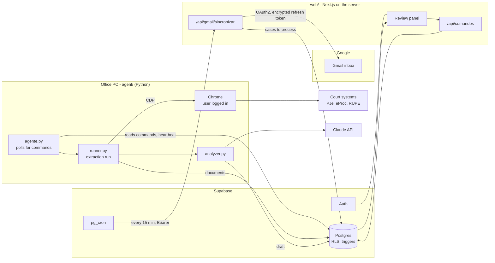

# legal-docket-automation

[](https://github.com/leonardo-merlo/legal-docket-automation/actions/workflows/ci.yml)

Docket automation for a small Brazilian law firm: it reads the daily court-publication e-mail, pulls each case's documents from the court websites, and has an LLM draft the next step and deadline for a lawyer to review.

> **About this repository.** The system runs in production for a real client. It was built over five months (June–October 2026) in two private repositories (214 commits). This is a sanitized copy of the current state: client names, people, case numbers and e-mails were replaced with fictitious values ("Exemplo Advogados", "Rafael", "Helena", "Marina"). Code comments and identifiers are in Portuguese, the language of the team and the domain.

## The problem

Every business day the firm receives an e-mail listing the court publications that mention its lawyers. For each case, someone had to open the right court system, read the new documents, decide what to do next and work out the legal deadline in business days. That was hours of manual work, and a missed deadline means losing the case.

## What it does

- **E-mail ingestion (Gmail API).** A scheduled job (`pg_cron`, every 15 minutes) calls an API route that reads new publication e-mails, checks the sender with Gmail's `Authentication-Results`, parses the case numbers (CNJ) and queues them. A "shadow" mode records what it would do without touching the queue.
- **Routing.** Each CNJ number is routed to the court system that holds it, mainly from the number itself (court segment, tribunal, origin). The label in the e-mail can only refine the choice within the same court.
- **Document extraction (Playwright).** A local agent drives the lawyer's own Chrome, already logged in, over the DevTools protocol and extracts the case documents from five court systems: PJe TJMG, eProc TJMG, RUPE (TJMG 2nd instance), eProc JFMG and eProc TRF6. *Planned:* PJe TJRJ and eProc TRF2 are mapped but have no extractor yet.
- **LLM analysis (Claude).** The documents, plus a reference of the Brazilian Civil Procedure Code, go to Claude (`claude-haiku-5-5`). It returns a JSON draft: suggested status, legal and internal deadlines, risk, next action and responsible lawyer. Token usage and cost in USD are stored with each draft.
- **Review panel (Next.js).** Lawyers approve, edit or reject each draft. A rejection requires a reason, and every review is recorded so the analysis quality can be measured. Approved drafts become tasks with deadlines, which can be forwarded to another lawyer.
- **Remote control of the agent.** The panel starts and stops extraction runs on the office computers. It also shows which computers are online, the progress of the current run and why a case failed.
- **Auth.** Supabase Auth with invite-only accounts, password reset and three roles (manager, lawyer, intern).

## Screenshots

<!-- TODO: add screenshots or a short GIF of the panel (review screen, dashboard, agent control). -->

_No public demo: the system holds client data. Screenshots coming soon._

## Architecture



The agent never opens a port. It only polls Supabase, so it works behind any office network, and the panel never talks to the office computer directly.

## Tech stack

| Part | Stack |
|---|---|
| `web/` | Next.js 16 (App Router, Server Actions), React 19, TypeScript 5 (strict), Tailwind CSS 4, `@supabase/ssr` and `supabase-js` |
| `agent/` | Python 3, Playwright (Chromium over CDP), Anthropic Python SDK, `supabase-py` |
| Database | Supabase: Postgres, Row Level Security, PL/pgSQL triggers, `pg_cron`, Vault, Auth |
| Integrations | Gmail API (OAuth2, called with `fetch`), Claude API |
| Tests | Node's built-in test runner (`node:test`) for `web/`, pytest for `agent/` |
| CI | GitHub Actions (Ubuntu for `web/`, Windows for `agent/`) |

## Key technical decisions

1. **Reuse the lawyer's logged-in browser instead of storing court passwords.** The court systems need personal certificates or 2FA, so the agent attaches to the user's own Chrome over the DevTools protocol (`agent/sistema_auth.py`). It detects whether the page is still asking for a login before extracting. The eProc login form disguises its password field, so the check reads the visible fields rather than relying on `type="password"`.
2. **Recover from a stuck tab instead of aborting the run.** A single tab that stops answering freezes Playwright's `connect_over_cdp` for every case. `agent/chrome_saude.py` probes each tab with a short timeout, closes the silent ones through the debug endpoint, opens a fresh tab and continues. Only a dead Chrome sends the queue back. `test_chrome_recuperacao.py` reproduces this against a real headless Chrome.
3. **Business rules enforced in the database.** Allowed statuses are `CHECK` constraints, and a rejected review must carry a reason (`revisoes_rascunho_rejeicao_com_motivo_check`). Triggers keep one row per court publication (`sincronizar_publicacao`) and stop a new LLM analysis from overwriting a draft a lawyer may be reading: the new analysis becomes a new row (`rascunho_nao_sobrescreve`). See [`db/schema.sql`](db/schema.sql).
4. **Deny by default on the database.** RLS is enabled on every table, and only two tables have a read policy for logged-in users. Every other read and write goes through server-side code with the service-role key, after the route checks the user's role.
5. **Treat the incoming e-mail as untrusted.** Ingestion accepts a message only if Gmail's own outermost `Authentication-Results` header shows DKIM, DMARC or SPF passing for the sender's domain (`web/lib/gmail/autenticacao.ts`). The Gmail refresh token is stored encrypted with AES-256-GCM (`web/lib/gmail/cripto.ts`). The cron endpoint compares its Bearer secret in constant time.

## Testing

```bash
# web/: 149 tests with node:test (parser, routing, Gmail auth, crypto, metrics)
cd web
npm test
npm run lint
npx tsc --noEmit

# agent/: 202 tests with pytest (routing, run outcomes, Chrome recovery, LLM output checks)
cd agent
pip install -r requirements-dev.txt
pytest
```

The agent tests fake the court systems, Supabase and the Claude API, so they run without credentials. The exception is `test_chrome_recuperacao.py`, which starts a throwaway headless Chrome and skips itself if Chrome is not installed. Two manual checks that need a real Chrome session or a paid API call live in `agent/tools/` and are not part of CI.

CI runs all of the above on every pull request (`.github/workflows/ci.yml`), except `test_chrome_recuperacao.py`: the hosted runner's Chrome does not freeze on an alert the way the office machines do, so that test runs locally only.

## Getting started

You need Node 22, Python 3.13 (the version CI uses), Google Chrome and a Supabase project.

```bash
# 1. Database: run db/schema.sql in the Supabase SQL editor.

# 2. Web panel
cd web
cp .env.example .env.local    # fill in Supabase, Google OAuth and the encryption key
npm install
npm run dev                   # http://localhost:3000

# 3. Agent (Windows)
cd agent
python -m venv venv
venv\Scripts\activate
pip install -r requirements.txt
copy .env.example .env        # Anthropic key and Supabase service key
python agente.py
```

The agent expects Chrome to be started with `--remote-debugging-port=9222` (`agent/windows/iniciar-chrome-debug.bat`) and the user to be logged in to the court systems. Every environment variable is listed with a comment in `web/.env.example` and `agent/.env.example`.

## Repository layout

```
web/      Next.js panel (app/, components/, lib/) and its specs and docs
agent/    Python agent: extractors, runner, analyzer, tests next to each module
  tools/    manual diagnostics (not run in CI)
  windows/  .bat launchers used on the office computers
  cpc/      Civil Procedure Code reference sent to the LLM
db/       Postgres schema (structure only)
```
